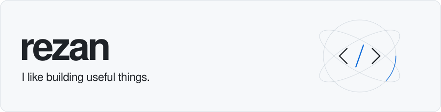

<picture>
  <source media="(prefers-color-scheme: dark) and (max-width: 640px)" srcset="assets/header-mobile-dark.svg">
  <source media="(prefers-color-scheme: light) and (max-width: 640px)" srcset="assets/header-mobile-light.svg">
  <source media="(prefers-color-scheme: dark)" srcset="assets/header-dark.svg">
  <source media="(prefers-color-scheme: light)" srcset="assets/header-light.svg">
  
</picture>

 

### Student & software developer from Germany.

### Focus

I’m interested in web apps, product development and AI. I like learning by building things and trying out new ideas.

### Technologies

  <picture>
    <source media="(prefers-color-scheme: dark)" srcset="assets/tech-typescript-dark.svg">
    
  </picture>
  <picture>
    <source media="(prefers-color-scheme: dark)" srcset="assets/tech-react-dark.svg">
    
  </picture>
  <picture>
    <source media="(prefers-color-scheme: dark)" srcset="assets/tech-nextjs-dark.svg">
    
  </picture>
  <picture>
    <source media="(prefers-color-scheme: dark)" srcset="assets/tech-tailwind-dark.svg">
    
  </picture>
  <picture>
    <source media="(prefers-color-scheme: dark)" srcset="assets/tech-nodejs-dark.svg">
    
  </picture>
  <picture>
    <source media="(prefers-color-scheme: dark)" srcset="assets/tech-bun-dark.svg">
    
  </picture>
  <picture>
    <source media="(prefers-color-scheme: dark)" srcset="assets/tech-postgresql-dark.svg">
    
  </picture>

---

### Let's connect

[Email](mailto:contact@rezanyalcin.de) &nbsp;·&nbsp; [WhatsApp](https://wa.me/message/3IKELGHHR5YDH1) &nbsp;·&nbsp; [GitHub](https://github.com/r-yalcin)
